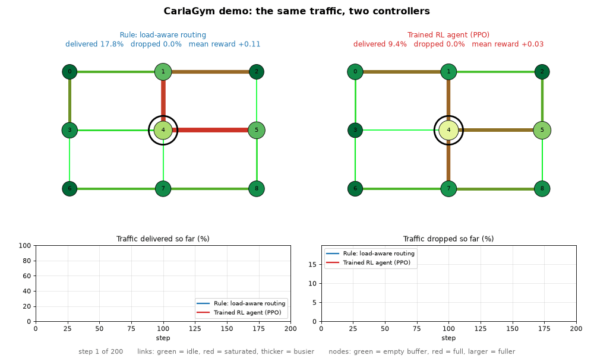
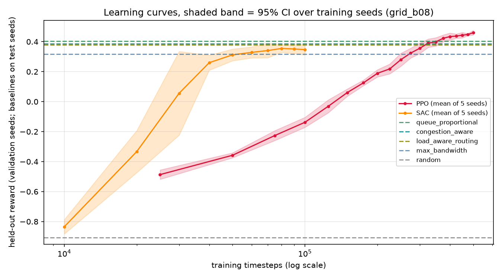

# CarlaGym

<p align="center">
   <br>
   A Gymnasium environment for reinforcement learning on congested network traffic
</p>

CarlaGym is a Python reinforcement-learning framework built on the standard
[Gymnasium](https://gymnasium.farama.org/) API. An agent controls a congested
packet network: every step it decides **how much bandwidth each link gets** and
**how traffic is routed**, and it is rewarded on QoS metrics (throughput, delay,
packet loss, deadline misses). The framework ships with customizable
topologies, volatile synthetic and dataset-driven traffic, node-bottleneck
scenarios, rule-based traffic-engineering baselines, and scripts to train,
evaluate and benchmark RL agents against them.

Traffic generation, the network simulator and the reward are decoupled from
the `gymnasium.Env` loop (an architecture inspired by `mobile-env`), so each
can be replaced independently.

## Layout

```
carla_gym/
  env.py                  # CarlaGymEnv(gymnasium.Env): spaces, step()/reset()
  marl_env.py             # MultiAgentCarlaGymEnv (PettingZoo ParallelEnv)
  baselines.py            # rule-based reference policies (bandwidth and routing-aware)
  core/
    network.py            # topologies, node buffers, link service, store-and-forward
    step.py               # one simulation step, shared by both envs
    traffic.py            # Poisson QoS traffic (voice / gaming / video / best-effort)
    trace_traffic.py      # dataset-driven traffic: TraceTrafficGenerator
    dataset_adapters.py   # raw dataset -> (step, src, dst, volume) trace
  utils/
    reward.py             # R = Throughput - k*Delay - c*PacketLoss - m*DeadlineMiss
    stats.py              # 95% confidence intervals
    qos.py                # episode-aggregate delivered / dropped / delay
    visualization.py      # Matplotlib congestion rendering
examples/
  random_agent_test.py    # sanity run: all baselines, pandas log, six checks
  train_agent.py          # train PPO / SAC / TD3, held-out evaluation vs baselines
  train_ppo.py            # shortcut for train_agent.py --algo ppo
  demo.py                 # animated side-by-side comparison of two policies
scripts/
  prepare_trace.py        # raw dataset -> trace CSV
  run_benchmark.py        # baseline scenario matrix with confidence intervals
  summarize_training.py   # aggregate multi-seed training runs
  evaluate_saved.py       # delivered / dropped / delay table for saved agents
  update_readme_results.py  # copy result tables from results/ into this file
notebooks/                # four executed notebooks (see below)
data/                     # dataset-derived traces (raw sources are not distributed)
results/                  # outputs of the runs reported below
tests/                    # pytest suite
qa/                       # reproduction scripts and logs for the QA round
docs/                     # tester report and researcher note
```

## Install

Python 3.10 or newer.

PowerShell (Windows):

```powershell
python -m venv .venv
.\.venv\Scripts\Activate.ps1
pip install -r requirements.txt -c constraints.txt
$env:PYTHONPATH = "."
```

bash (Linux / macOS):

```bash
python3 -m venv .venv && source .venv/bin/activate
pip install -r requirements.txt -c constraints.txt
export PYTHONPATH=.
```

`constraints.txt` pins the versions everything here was run with; drop
`-c constraints.txt` to take the newest compatible releases. As a package:
`pip install -e .` for the core environment, or `pip install -e ".[all]"` to add
the extras `rl` (PyTorch, Stable-Baselines3), `marl` (PettingZoo), `notebooks`
and `dev`.

The commands below are the same in both shells once `PYTHONPATH` is set.

```
python -m pytest -q
python examples/random_agent_test.py --episodes 3 --steps 150 --budget 0.8
python examples/train_agent.py --algo ppo --timesteps 500000 --seed 0
python scripts/run_benchmark.py --quick
```

## Quick start

```python
import gymnasium as gym
import carla_gym  # registers CarlaGym-v0

env = gym.make("CarlaGym-v0", topology="grid", num_nodes=9, bandwidth_budget=0.8)
obs, info = env.reset(seed=0)
for _ in range(200):
    obs, reward, terminated, truncated, info = env.step(env.action_space.sample())
    if terminated or truncated:
        obs, info = env.reset()
```

Main constructor options: `topology` (`grid`, `ring`, `star`, `mesh`,
`random`), `num_nodes`, `link_capacity`, `node_buffer`, `load_scale`,
`bandwidth_budget`, `bottlenecks`, `traffic`, reward coefficients `k`, `c`,
`m`, `delay_reference`, `max_steps`, `render_mode` (`human` or `rgb_array`).

## Demo



```
python examples/demo.py                                   # live window
python examples/demo.py --save demo.gif                   # write the animation to a file
python examples/demo.py --left max_bandwidth --right queue_proportional
python examples/demo.py --seed 2005 --bottleneck 4:0.5
```

Two controllers receive exactly the same traffic. Links are coloured from
green (idle) to red (saturated), nodes by how full their buffers are, and
the charts track the share of offered traffic each side has delivered and
dropped so far. `--left` and `--right` take any baseline name, or `ppo` /
`sac` for an agent saved by `examples/train_agent.py`. The saved agents were
trained on the default scenario (3x3 grid, budget 0.8); `--seed` values from
2000 upwards are traffic they never saw. The percentages cover the whole
episode from step 0, so they differ slightly from the tables below, which
skip a 20-step warm-up.

## Simulation model

The environment is a **store-and-forward** packet simulator, not a flow-rate
approximation.

* **Nodes** hold finite buffers. Packets physically occupy them.
* **Links** are undirected and have a service rate (units per step) shared by
  both directions. The bandwidth action scales that rate.
* Packets advance **at most one hop per step**. Service is **fractional**: a
  packet larger than the budget a link has left is partly transmitted and
  finishes the hop on a later step, so any positive allocation moves traffic.
* Each node keeps **one FIFO queue per outgoing link**, all sharing the
  node's buffer. A packet waiting for an exhausted link blocks only traffic
  for that link (`queueing="shared_fifo"` restores one FIFO per node, where
  the head packet blocks every link).
* Nodes are served in a **fresh random order each step**, so no node gets
  first use of a shared link because of its id (`service_order="id"`).
* A packet moves on only if the next node had room at the start of the step
  (plus what has arrived since); otherwise it is dropped. Buffers therefore
  never exceed `node_buffer`.
* **Routing** is decided when a packet is admitted: shortest path under the
  per-link routing weights in the current action. Among equal-cost next
  hops the packet picks one at random (per-packet ECMP); `tie_break="first"`
  takes the lowest id. Uniform weights give hop-count shortest paths.
* **Randomness**: `seed` drives traffic, tie-breaks and service order; the
  `random` topology is drawn from `topology_seed` (default 0), so the graph
  and the action space do not change with the episode seed.
* **Latency is measured** in steps from injection to delivery.
* **Loss** occurs on admission overflow, downstream buffer overflow, or when
  no route exists.

### Spaces

`E` = number of links, `N` = number of nodes (default grid: `E=12`, `N=9`).

| | Shape | Meaning |
|---|---|---|
| Observation | `Box(0, 1, (2E+N,))` | link utilization (E), pending demand per link (E), node buffer occupancy (N) |
| Action | `Box(0, 1, (2E,))` | per-link bandwidth weight (E), then per-link routing weight (E) |

`bandwidth_budget=b` caps the sum of bandwidth weights at `b*E`; actions above
it are scaled down proportionally. Without a budget, "allocate everything
everywhere" is close to optimal and the allocation problem is uninteresting.

### Reward

```
R = Throughput - k*Delay - c*PacketLoss - m*DeadlineMiss        (defaults k=0.5, c=1.0, m=0.5)
```

Every term is normalized to [0, 1] per step:

* **Throughput**: delivered / offered units, clipped at 1.
* **Delay**: delay-sensitivity-weighted mean age of traffic in the system
  (end-to-end delay of packets delivered this step, current age of packets
  still queued), divided by `delay_reference` (10 steps) and clipped at 1.
  It is QoS-weighted, not plain latency: voice and gaming cost more per step
  than best-effort.
* **PacketLoss**: dropped / offered units, clipped at 1.
* **DeadlineMiss**: packets that missed their class deadline this step
  (delivered late, or expired while queued) over packets resolved this step.
  Each packet is counted once.

The reward is therefore in [-2, 1]. `info` reports every term and the raw
counters. The terms are per-step quantities; for the fraction of traffic
delivered or dropped over an episode, aggregate the raw counters
(`carla_gym.utils.qos.EpisodeQoS`).

### Traffic

`TrafficGenerator` draws Poisson arrivals for four QoS classes with different
packet sizes, delay sensitivities and deadlines (about 104 units per step at
`load_scale=1`). `TraceTrafficGenerator` replays a `step,src,dst,volume` CSV,
rescaled to a `target_load`. Any object with `generate(step)` and
`reset(seed)` can be passed as `traffic=`.

Seeding: `reset(seed=s)` replays the same traffic; `reset()` continues the
random stream, so successive episodes see new traffic.

### Node bottlenecks

`bottlenecks={node: scale}` degrades a node: it keeps only that fraction of
its buffer and of the capacity of every link touching it. This is the
scenario for studying bottleneck mitigation: a policy has to steer traffic
around the degraded node or prioritise its links.

### Multi-agent

`MultiAgentCarlaGymEnv` exposes the same simulator through the PettingZoo
parallel API. Each link is controlled by exactly one of its endpoint nodes;
nodes that control no link are not agents. Agents share the global
observation and a cooperative reward. `step()` needs one action for every
live agent and raises otherwise. It needs the `marl` extra.

## Baselines

All in `carla_gym/baselines.py`:

| Policy | Bandwidth | Routing |
|---|---|---|
| `max_bandwidth` | equal split over all links | hop-count shortest path |
| `queue_proportional` | proportional to each link's pending demand | hop-count shortest path |
| `load_aware_routing` | equal split | load-aware shortest path (congested links cost more) |
| `congestion_aware` | proportional to pending demand | load-aware shortest path |
| `random` | uniform random | uniform random |
| `min_bandwidth` | 5% everywhere | hop-count shortest path |

`load_aware_routing` and `congestion_aware` are the routing-aware
traffic-engineering baselines.

## Results

Everything in this section is copied from files under `results/` by
`scripts/update_readme_results.py`; the commands that produced them are shown.
Rewards are the mean per-step reward after a 20-step warm-up, over 200-step
episodes.

### RL agents vs baselines (3x3 grid, synthetic traffic, budget 0.8)

> **These runs used the 0.3.0 simulator** (one FIFO per node, fixed
> tie-breaks, nodes served in id order) and have not yet been repeated on
> 0.4.0. They are not comparable with the baseline matrix below, and under
> 0.4.0 every baseline delivers about 95% of traffic in this scenario
> (`qa/research/probe_after_fixes.log`), so it is no longer a congested
> setting.

```
python examples/train_agent.py --algo ppo --timesteps 500000 --seed S --eval-every 25000 --out results/grid_b08/ppo_seedS
python examples/train_agent.py --algo sac --timesteps 100000 --seed S --eval-every 10000 --out results/grid_b08/sac_seedS
python scripts/summarize_training.py results/grid_b08
```

for `S` in 0..4. Agents train on a `[-1, 1]` action space
(`gymnasium.wrappers.RescaleAction`). Training envs draw fresh traffic every
episode, learning curves use validation seeds (1000+), and the table uses test
seeds (2000 to 2009) that neither training nor the curves saw. For RL agents
the interval is over the five training seeds; for baselines it is over the ten
test episodes, each averaged over the ten run directories (this only matters
for `random`, whose actions differ per run).

<!-- RESULTS:training:start -->
| Policy | Kind | Reward (mean ± 95% CI) | n | CI over |
|---|---|---:|---:|---|
| PPO | RL agent | +0.494 ± 0.013 | 5 | training seeds |
| queue_proportional | baseline | +0.404 ± 0.024 | 10 | test episodes |
| congestion_aware | baseline | +0.386 ± 0.021 | 10 | test episodes |
| SAC | RL agent | +0.383 ± 0.028 | 5 | training seeds |
| load_aware_routing | baseline | +0.378 ± 0.026 | 10 | test episodes |
| max_bandwidth | baseline | +0.317 ± 0.030 | 10 | test episodes |
| random | baseline | -0.901 ± 0.026 | 10 | test episodes |
| min_bandwidth | baseline | -1.803 ± 0.008 | 10 | test episodes |
<!-- RESULTS:training:end -->



The same agents and baselines in network terms (`python scripts/evaluate_saved.py results/grid_b08`):

<!-- RESULTS:training_qos:start -->
Episode aggregates over steps 20..199 of test seeds 2000..2009, mean ± 95% CI (agents: over training seeds; baselines: over test episodes). Delivered % and Dropped % are of traffic offered in the same window; the remainder is backlog growth.

| Policy | Reward | Delivered % | Dropped % | Delay of delivered packets (steps) | Deadline misses per delivered packet |
|---|---:|---:|---:|---:|---:|
| PPO | +0.494 | 92.2 ± 0.5 | 7.7 ± 0.5 | 3.89 ± 0.07 | 0.192 ± 0.008 |
| queue_proportional | +0.404 | 87.0 ± 1.4 | 13.0 ± 1.4 | 3.88 ± 0.06 | 0.194 ± 0.005 |
| congestion_aware | +0.386 | 86.6 ± 1.0 | 13.4 ± 1.0 | 4.00 ± 0.07 | 0.211 ± 0.009 |
| SAC | +0.383 | 87.6 ± 0.9 | 12.3 ± 0.9 | 4.30 ± 0.22 | 0.237 ± 0.021 |
| load_aware_routing | +0.378 | 86.2 ± 1.2 | 13.9 ± 1.3 | 4.00 ± 0.12 | 0.212 ± 0.014 |
| max_bandwidth | +0.317 | 82.6 ± 1.5 | 17.3 ± 1.5 | 4.02 ± 0.09 | 0.208 ± 0.011 |
| random | -0.898 | 39.4 ± 1.5 | 60.3 ± 1.7 | 12.01 ± 0.32 | 0.867 ± 0.026 |
| min_bandwidth | -1.803 | 3.6 ± 0.2 | 96.4 ± 0.2 | 81.59 ± 1.37 | 4.194 ± 0.240 |
<!-- RESULTS:training_qos:end -->

Read "delivered" and "dropped" from this table, not from the reward terms:
the `throughput` and `loss` terms in the reward are ratios within a single
step (and throughput is clipped at 1), so their average over an episode is
not the fraction of traffic delivered.

### Baseline scenario matrix

```
python scripts/run_benchmark.py
```

<!-- RESULTS:benchmark:start -->
Mean post-warmup reward ± 95% CI over 10 seeds (2000..2009), 200 steps, warmup 20.
**Bold**: best policy, its interval overlaps no other. `~`: best group, intervals overlap (a statistical tie).

| Scenario | random | min_bandwidth | max_bandwidth | queue_proportional | load_aware_routing | congestion_aware |
|---|---:|---:|---:|---:|---:|---:|
| grid/load x0.5/budget 0.8 | +0.435 ± 0.017 | -1.481 ± 0.016 | **+0.720 ± 0.008** | +0.614 ± 0.010 | +0.695 ± 0.007 | +0.586 ± 0.010 |
| grid/load x0.5/budget 0.5 | +0.386 ± 0.024 | -1.481 ± 0.016 | +0.627 ± 0.013 ~ | +0.604 ± 0.007 | +0.626 ± 0.006 ~ | +0.582 ± 0.010 |
| grid/load x1/budget 0.8 | -0.284 ± 0.034 | -1.691 ± 0.005 | +0.631 ± 0.011 | +0.600 ± 0.011 | **+0.665 ± 0.012** | +0.587 ± 0.012 |
| grid/load x1/budget 0.5 | -0.392 ± 0.027 | -1.691 ± 0.005 | -0.028 ± 0.020 | +0.119 ± 0.030 ~ | +0.052 ± 0.041 | +0.133 ± 0.033 ~ |
| grid/load x2/budget 0.8 | -1.021 ± 0.022 | -1.793 ± 0.005 | -0.211 ± 0.020 | -0.154 ± 0.022 ~ | -0.169 ± 0.018 ~ | -0.137 ± 0.018 ~ |
| grid/load x2/budget 0.5 | -1.088 ± 0.022 | -1.793 ± 0.005 | -0.909 ± 0.014 | -0.871 ± 0.014 ~ | -0.891 ± 0.014 | -0.862 ± 0.009 ~ |
| ring/load x0.5/budget 0.8 | -0.082 ± 0.042 | -1.675 ± 0.017 | +0.630 ± 0.010 ~ | +0.535 ± 0.007 | +0.611 ± 0.012 ~ | +0.520 ± 0.010 |
| ring/load x0.5/budget 0.5 | -0.186 ± 0.044 | -1.675 ± 0.017 | +0.165 ± 0.069 ~ | +0.276 ± 0.059 ~ | +0.167 ± 0.063 ~ | +0.263 ± 0.057 ~ |
| ring/load x1/budget 0.8 | -0.916 ± 0.035 | -1.814 ± 0.009 | -0.003 ± 0.043 ~ | +0.030 ± 0.038 ~ | -0.013 ± 0.045 ~ | +0.036 ± 0.043 ~ |
| ring/load x1/budget 0.5 | -0.990 ± 0.025 | -1.814 ± 0.009 | -0.855 ± 0.034 ~ | -0.843 ± 0.031 ~ | -0.860 ± 0.029 ~ | -0.844 ± 0.026 ~ |
| ring/load x2/budget 0.8 | -1.408 ± 0.013 | -1.870 ± 0.004 | -0.940 ± 0.019 ~ | -0.920 ± 0.017 ~ | -0.940 ± 0.014 ~ | -0.921 ± 0.015 ~ |
| ring/load x2/budget 0.5 | -1.458 ± 0.011 | -1.870 ± 0.004 | -1.407 ± 0.011 ~ | -1.401 ± 0.015 ~ | -1.405 ± 0.013 ~ | -1.401 ± 0.013 ~ |
| star/load x0.5/budget 0.8 | +0.199 ± 0.036 | -1.543 ± 0.024 | +0.660 ± 0.010 ~ | +0.484 ± 0.018 | +0.660 ± 0.010 ~ | +0.484 ± 0.018 |
| star/load x0.5/budget 0.5 | +0.103 ± 0.050 | -1.543 ± 0.024 | +0.395 ± 0.034 ~ | +0.421 ± 0.023 ~ | +0.395 ± 0.034 ~ | +0.421 ± 0.023 ~ |
| star/load x1/budget 0.8 | -0.738 ± 0.030 | -1.718 ± 0.010 | +0.073 ± 0.028 ~ | +0.012 ± 0.018 | +0.073 ± 0.028 ~ | +0.012 ± 0.018 |
| star/load x1/budget 0.5 | -0.862 ± 0.030 | -1.718 ± 0.010 | -0.674 ± 0.031 ~ | -0.628 ± 0.033 ~ | -0.674 ± 0.031 ~ | -0.628 ± 0.033 ~ |
| star/load x2/budget 0.8 | -1.310 ± 0.009 | -1.781 ± 0.009 | -0.843 ± 0.009 ~ | -0.842 ± 0.009 ~ | -0.843 ± 0.009 ~ | -0.842 ± 0.009 ~ |
| star/load x2/budget 0.5 | -1.381 ± 0.010 | -1.781 ± 0.009 | -1.289 ± 0.009 ~ | -1.282 ± 0.010 ~ | -1.289 ± 0.009 ~ | -1.282 ± 0.010 ~ |
| mesh/load x0.5/budget 0.8 | +0.635 ± 0.010 | -0.077 ± 0.031 | **+0.928 ± 0.002** | +0.736 ± 0.005 | +0.854 ± 0.004 | +0.702 ± 0.006 |
| mesh/load x0.5/budget 0.5 | +0.631 ± 0.011 | -0.077 ± 0.031 | **+0.863 ± 0.007** | +0.736 ± 0.005 | +0.817 ± 0.006 | +0.702 ± 0.006 |
| mesh/load x1/budget 0.8 | +0.541 ± 0.016 | -0.743 ± 0.019 | **+0.918 ± 0.002** | +0.781 ± 0.006 | +0.834 ± 0.005 | +0.733 ± 0.005 |
| mesh/load x1/budget 0.5 | +0.525 ± 0.019 | -0.743 ± 0.019 | **+0.857 ± 0.004** | +0.781 ± 0.006 | +0.802 ± 0.006 | +0.733 ± 0.005 |
| mesh/load x2/budget 0.8 | -0.023 ± 0.022 | -1.220 ± 0.006 | **+0.904 ± 0.002** | +0.812 ± 0.003 | +0.816 ± 0.004 | +0.728 ± 0.007 |
| mesh/load x2/budget 0.5 | -0.057 ± 0.021 | -1.220 ± 0.006 | **+0.857 ± 0.003** | +0.812 ± 0.003 | +0.783 ± 0.004 | +0.730 ± 0.004 |
| random/load x0.5/budget 0.8 | +0.495 ± 0.027 | -1.326 ± 0.020 | **+0.750 ± 0.008** | +0.665 ± 0.005 | +0.708 ± 0.007 | +0.601 ± 0.008 |
| random/load x0.5/budget 0.5 | +0.461 ± 0.036 | -1.326 ± 0.020 | **+0.691 ± 0.012** | +0.665 ± 0.006 | +0.655 ± 0.011 | +0.597 ± 0.009 |
| random/load x1/budget 0.8 | -0.190 ± 0.041 | -1.589 ± 0.011 | +0.682 ± 0.023 ~ | +0.657 ± 0.008 ~ | +0.678 ± 0.014 ~ | +0.598 ± 0.011 |
| random/load x1/budget 0.5 | -0.268 ± 0.047 | -1.589 ± 0.011 | +0.055 ± 0.047 | **+0.602 ± 0.020** | +0.115 ± 0.041 | +0.487 ± 0.026 |
| random/load x2/budget 0.8 | -0.910 ± 0.026 | -1.721 ± 0.006 | -0.080 ± 0.022 | **+0.221 ± 0.019** | -0.045 ± 0.024 | +0.189 ± 0.014 |
| random/load x2/budget 0.5 | -0.974 ± 0.023 | -1.721 ± 0.006 | -0.792 ± 0.025 | -0.396 ± 0.018 ~ | -0.767 ± 0.021 | -0.405 ± 0.024 ~ |
| grid/bottleneck node 4 x0.5/budget 0.8 | -0.888 ± 0.033 | -1.737 ± 0.007 | -0.151 ± 0.021 | +0.143 ± 0.015 | +0.400 ± 0.014 ~ | +0.377 ± 0.017 ~ |
| pcap trace/load 40/grid-16/budget 0.8 | -0.057 ± 0.016 | -0.976 ± 0.023 | +0.220 ± 0.015 | +0.235 ± 0.015 ~ | +0.266 ± 0.017 ~ | +0.127 ± 0.019 |
| pcap trace/load 40/grid-16/budget 0.5 | -0.084 ± 0.015 | -0.976 ± 0.023 | +0.002 ± 0.013 | **+0.235 ± 0.015** | +0.114 ± 0.020 | +0.127 ± 0.019 |
| pcap trace/load 110 (overload)/grid-16/budget 0.8 | -0.399 ± 0.022 | -1.219 ± 0.029 | -0.085 ± 0.017 | -0.039 ± 0.016 ~ | -0.013 ± 0.016 ~ | -0.077 ± 0.023 |
| pcap trace/load 110 (overload)/grid-16/budget 0.5 | -0.434 ± 0.025 | -1.219 ± 0.029 | -0.345 ± 0.016 | -0.039 ± 0.016 ~ | -0.296 ± 0.024 | -0.073 ± 0.023 ~ |
| cs448b trace/load 110 (stress case)/grid-16/budget 0.8 | +0.161 ± 0.040 | -1.328 ± 0.020 | **+0.556 ± 0.009** | +0.470 ± 0.020 | +0.520 ± 0.009 | +0.364 ± 0.021 |
| cs448b trace/load 110 (stress case)/grid-16/budget 0.5 | +0.136 ± 0.040 | -1.328 ± 0.020 | +0.351 ± 0.021 | **+0.470 ± 0.020** | +0.415 ± 0.011 | +0.365 ± 0.021 |
<!-- RESULTS:benchmark:end -->

In most scenarios the leading heuristics are statistically tied; a policy is
bold only where its interval overlaps no other. Rows where every policy is
far below zero are overloaded regimes in which no policy can do well.

Traffic delivered and dropped in the same runs:

<!-- RESULTS:benchmark_qos:start -->
Traffic delivered / dropped, as % of traffic offered after warm-up (episode aggregate; the rest is backlog growth).

| Scenario | random | min_bandwidth | max_bandwidth | queue_proportional | load_aware_routing | congestion_aware |
|---|---:|---:|---:|---:|---:|---:|
| grid/load x0.5/budget 0.8 | 96.6 / 3.4 | 13.6 / 84.9 | 100.2 / 0.0 | 100.1 / 0.2 | 100.2 / 0.0 | 99.9 / 0.3 |
| grid/load x0.5/budget 0.5 | 95.3 / 4.6 | 13.6 / 84.9 | 99.5 / 0.7 | 99.9 / 0.3 | 100.0 / 0.1 | 99.9 / 0.2 |
| grid/load x1/budget 0.8 | 62.4 / 37.4 | 6.7 / 93.2 | 95.5 / 4.4 | 95.3 / 4.7 | 97.5 / 2.4 | 95.2 / 4.7 |
| grid/load x1/budget 0.5 | 58.7 / 41.0 | 6.7 / 93.2 | 72.5 / 27.1 | 77.7 / 22.0 | 76.3 / 23.3 | 78.9 / 20.7 |
| grid/load x2/budget 0.8 | 29.9 / 70.2 | 3.3 / 96.7 | 56.4 / 43.7 | 58.2 / 41.8 | 57.9 / 42.0 | 58.9 / 41.2 |
| grid/load x2/budget 0.5 | 28.0 / 72.0 | 3.3 / 96.7 | 33.8 / 66.2 | 34.6 / 65.4 | 34.5 / 65.5 | 34.8 / 65.2 |
| ring/load x0.5/budget 0.8 | 82.0 / 17.5 | 6.5 / 92.2 | 100.1 / 0.1 | 100.1 / 0.3 | 100.1 / 0.1 | 100.1 / 0.3 |
| ring/load x0.5/budget 0.5 | 77.2 / 21.9 | 6.5 / 92.2 | 90.5 / 8.9 | 94.6 / 5.0 | 90.8 / 8.5 | 94.5 / 5.4 |
| ring/load x1/budget 0.8 | 39.3 / 60.6 | 3.1 / 96.8 | 73.7 / 26.1 | 75.1 / 24.8 | 73.5 / 26.3 | 74.9 / 24.9 |
| ring/load x1/budget 0.5 | 36.0 / 63.7 | 3.1 / 96.8 | 42.2 / 57.5 | 42.7 / 57.2 | 42.1 / 57.8 | 42.6 / 57.2 |
| ring/load x2/budget 0.8 | 17.9 / 82.2 | 1.7 / 98.3 | 31.2 / 68.9 | 31.6 / 68.5 | 31.2 / 68.9 | 31.7 / 68.4 |
| ring/load x2/budget 0.5 | 16.2 / 83.8 | 1.7 / 98.3 | 17.9 / 82.1 | 18.3 / 81.7 | 18.1 / 81.9 | 18.3 / 81.7 |
| star/load x0.5/budget 0.8 | 74.7 / 25.4 | 11.1 / 87.3 | 94.0 / 6.0 | 85.8 / 14.2 | 94.0 / 6.0 | 85.8 / 14.2 |
| star/load x0.5/budget 0.5 | 71.2 / 28.9 | 11.1 / 87.3 | 82.4 / 17.7 | 83.2 / 16.9 | 82.4 / 17.7 | 83.2 / 16.9 |
| star/load x1/budget 0.8 | 37.2 / 62.3 | 5.5 / 94.5 | 59.4 / 40.7 | 56.5 / 43.7 | 59.4 / 40.7 | 56.5 / 43.7 |
| star/load x1/budget 0.5 | 34.7 / 64.7 | 5.5 / 94.5 | 40.4 / 58.7 | 40.7 / 58.4 | 40.4 / 58.7 | 40.7 / 58.4 |
| star/load x2/budget 0.8 | 19.2 / 80.9 | 2.9 / 97.1 | 28.6 / 71.3 | 28.6 / 71.5 | 28.6 / 71.3 | 28.6 / 71.5 |
| star/load x2/budget 0.5 | 18.3 / 81.7 | 2.9 / 97.1 | 20.8 / 79.2 | 21.0 / 79.0 | 20.8 / 79.2 | 21.0 / 79.0 |
| mesh/load x0.5/budget 0.8 | 100.2 / 0.0 | 82.4 / 15.2 | 100.0 / 0.0 | 99.9 / 0.0 | 99.9 / 0.0 | 100.0 / 0.0 |
| mesh/load x0.5/budget 0.5 | 100.2 / 0.1 | 82.4 / 15.2 | 100.0 / 0.0 | 99.9 / 0.0 | 99.9 / 0.0 | 100.0 / 0.0 |
| mesh/load x1/budget 0.8 | 95.1 / 4.7 | 45.5 / 54.2 | 100.0 / 0.0 | 100.0 / 0.0 | 100.0 / 0.0 | 99.9 / 0.1 |
| mesh/load x1/budget 0.5 | 94.7 / 5.2 | 45.5 / 54.2 | 100.0 / 0.0 | 100.0 / 0.0 | 99.9 / 0.0 | 99.9 / 0.1 |
| mesh/load x2/budget 0.8 | 64.4 / 35.6 | 24.1 / 75.9 | 100.0 / 0.0 | 100.0 / 0.0 | 99.4 / 0.6 | 97.3 / 2.8 |
| mesh/load x2/budget 0.5 | 63.1 / 37.0 | 24.1 / 75.9 | 100.0 / 0.0 | 100.0 / 0.0 | 98.9 / 1.1 | 97.4 / 2.7 |
| random/load x0.5/budget 0.8 | 98.0 / 1.8 | 19.2 / 79.1 | 100.2 / 0.0 | 100.2 / 0.1 | 100.1 / 0.1 | 100.1 / 0.1 |
| random/load x0.5/budget 0.5 | 97.2 / 2.6 | 19.2 / 79.1 | 99.9 / 0.1 | 100.2 / 0.1 | 100.1 / 0.1 | 99.9 / 0.2 |
| random/load x1/budget 0.8 | 66.8 / 32.8 | 9.6 / 90.2 | 96.5 / 3.5 | 96.6 / 3.3 | 97.2 / 2.7 | 95.1 / 4.7 |
| random/load x1/budget 0.5 | 64.0 / 35.7 | 9.6 / 90.2 | 76.6 / 23.0 | 94.4 / 5.5 | 78.5 / 21.5 | 91.5 / 8.4 |
| random/load x2/budget 0.8 | 34.1 / 65.8 | 4.8 / 95.2 | 62.9 / 37.0 | 72.7 / 27.3 | 64.0 / 36.1 | 71.2 / 28.9 |
| random/load x2/budget 0.5 | 32.4 / 67.5 | 4.8 / 95.2 | 40.6 / 59.4 | 51.7 / 48.4 | 41.6 / 58.3 | 51.6 / 48.6 |
| grid/bottleneck node 4 x0.5/budget 0.8 | 38.3 / 61.6 | 5.1 / 94.9 | 63.2 / 36.3 | 73.2 / 26.6 | 85.0 / 14.8 | 84.3 / 15.7 |
| pcap trace/load 40/grid-16/budget 0.8 | 57.1 / 41.1 | 9.5 / 80.0 | 70.7 / 28.1 | 75.2 / 23.4 | 79.6 / 18.6 | 75.8 / 21.4 |
| pcap trace/load 40/grid-16/budget 0.5 | 55.7 / 42.5 | 9.5 / 80.0 | 57.1 / 41.4 | 75.2 / 23.4 | 70.5 / 27.3 | 75.8 / 21.4 |
| pcap trace/load 110 (overload)/grid-16/budget 0.8 | 29.5 / 69.2 | 3.4 / 92.0 | 39.3 / 60.1 | 42.7 / 56.6 | 45.9 / 53.1 | 45.7 / 53.0 |
| pcap trace/load 110 (overload)/grid-16/budget 0.5 | 28.5 / 70.1 | 3.4 / 92.0 | 29.8 / 69.2 | 42.7 / 56.6 | 33.8 / 64.6 | 45.6 / 53.2 |
| cs448b trace/load 110 (stress case)/grid-16/budget 0.8 | 38.7 / 61.8 | 6.6 / 91.9 | 44.3 / 55.9 | 44.5 / 56.0 | 45.9 / 54.6 | 44.6 / 56.0 |
| cs448b trace/load 110 (stress case)/grid-16/budget 0.5 | 38.1 / 62.3 | 6.6 / 91.9 | 40.8 / 59.7 | 44.5 / 56.0 | 44.8 / 55.8 | 44.6 / 55.9 |
<!-- RESULTS:benchmark_qos:end -->

The trace scenarios show why the delivered / dropped table matters. At a
mean load of 40 the pcap trace is loaded but workable: the four heuristics
(all policies except random and min_bandwidth) drop 19 to 41% of its traffic
and separate clearly at the tighter budget. At 110 it is in overload (53 to
69% dropped). The cs448b trace is a stress case: the heuristics drop 55 to
60% of it, because a few spike bins carry most of
its volume, yet its reward is positive. The reward averages per-step ratios,
so a quiet step counts as much as a heavy one (see Limitations).

## Datasets

Two dataset-derived traces ship in `data/`. Each is a `step,src,dst,volume`
CSV holding simulator node ids only:

| Trace | Derived from | Rows | Steps |
|---|---|---:|---:|
| `data/cs448b_trace.csv` | Daily flow counts per (local host, remote ASN) over 92 days, from a Stanford CS448B course dataset (`cs448b_ipasn.csv`). One simulation step = one day; the values are flow counts, not volumes. | 4,644 | 92 |
| `data/pcap_trace.csv` | A packet capture of about 21 minutes (exported from Wireshark), binned into 5-second steps; volume = bytes. | 4,163 | 252 (246 with traffic) |

**The raw files are not distributed.** The capture contains real IP
addresses and the flow-count file has no stated licence. The traces above
were produced from them by `dataset_adapters.py`, which maps addresses and
ASNs to 16 node ids through a hash, so no address appears in this repository's
current files. After rescaling to a target load only the *shape* of the load
over time and across node pairs survives: treat the traces as load shapes
derived from real measurements, not as a replay of real traffic.

```
python examples/train_agent.py --algo ppo --trace data/pcap_trace.csv --nodes 16 --load 40 --budget 0.5
```

To build a trace from your own data, put a CSV in one of the two supported
formats anywhere outside version control (`data/raw/` is git-ignored) and run:

```
python scripts/prepare_trace.py --in data/raw/my_capture.csv --out data/my_trace.csv --bin-seconds 5
```

Supported inputs: a flow-count table with columns `date, l_ipn, r_asn, f`; or
a packet-capture export with `Timestamp, Source IP, Destination IP, Length`
(numeric) or `Time, Source, Destination, Length` (Wireshark text export).

Design points:

* IP addresses and ASNs are bucketed into node ids with a stable MD5-based
  hash, so conversion is reproducible across processes and machines.
* Placement is topology-aware: the busiest buckets go to the best-connected
  nodes, so a traffic hub does not land on a two-link grid corner. For
  `--topology random`, pass `--topology-seed` equal to the env's seed.
* Trace volume is rescaled so the mean offered load per step, over all time
  bins including empty ones, equals `target_load`.
* Choose `target_load` well below the synthetic default. Trace load is
  concentrated on few node pairs and few time bins: on the 4x4 grid the pcap
  trace is a sensible scenario at a mean load of about 40 and is deep in
  overload at 110.
* The cs448b trace is a stress case, not a benchmark. Its busiest 10% of time
  bins carry 64% of the volume, so about half its traffic is lost at any mean
  load.

## Notebooks

All four are committed with executed outputs. To re-run one:

```
cd notebooks
python -m jupyter nbconvert --to notebook --execute --inplace 01_simulation_walkthrough.ipynb
```

| Notebook | What it shows |
|---|---|
| `01_simulation_walkthrough.ipynb` | The five topologies and their nodes, one episode step by step (backlog, utilization, the four reward terms), network renders, `rgb_array` output, a zero-bandwidth stress test and a node bottleneck. |
| `02_policy_comparison.ipynb` | All six baselines on synthetic traffic and on the pcap trace, with 95% intervals. |
| `03_dataset_exploration.ipynb` | The two dataset-derived traces: load over time, which node pairs carry it, the topology-aware placement, and both traces run through the simulator. |
| `04_ppo_training_curves.ipynb` | Learning curves of the saved multi-seed PPO and SAC runs, plus a short PPO run trained live on the pcap trace. |

## Tests

```
python -m pytest -q
```

<!-- RESULTS:tests:start -->
Last run: **160 passed**.
<!-- RESULTS:tests:end -->

The suite covers Gymnasium API conformance (`check_env`, including rendering),
PettingZoo `parallel_api_test` on all five topologies, packet-unit
conservation, buffer and link-capacity bounds, seeding, input validation, the
reward terms, the baselines, and the committed traces. Fourteen further
tests exercise the raw-data adapters; they need local copies of the raw
datasets in `data/raw/` and are skipped otherwise.

## Limitations

* Time is slotted and packets move one hop per step; there is no propagation
  delay, retransmission or transport-layer behaviour.
* A link's budget is shared by both directions. Which direction uses it
  first in a step depends on the (random) service order.
* Queues are FIFO per outgoing link; there is no per-class scheduling inside
  a node. QoS classes differ only in size, deadline and reward weight.
* A packet's route is fixed at admission; routing weights do not re-route
  packets already queued.
* There is no backpressure. A packet that has crossed a link is dropped if the
  next node's buffer was full at the start of the step, even if that node
  emptied during the step; two full neighbours sending to each other lose
  traffic. Space freed in a step is usable from the next step.
* The pending-demand observation counts a part-transmitted packet at its full
  size.
* Deadline misses are counted once per packet, but a packet that expires in a
  queue and is delivered later appears in the deadline term's denominator on
  both steps. Expiry is recorded one step after the miss became unavoidable.
* In a step with no offered traffic (for example after a non-looping trace
  ends) the throughput term is 0, so draining a backlog then earns no
  throughput credit.
* **The reward averages per-step ratios, so on strongly bursty load it is not
  a measure of delivered traffic.** A quiet step counts as much as a spike
  step. On the cs448b trace the reward of equal split rises from +0.21 to
  +0.40 as the mean load goes from 20 to 60 while the delivered fraction
  falls from 52% to 45% (`qa/research/trace_load_sweep.log`). On stationary
  synthetic traffic the reward and the delivered fraction rank policies the
  same way. Always report the delivered / dropped tables next to the reward
  for trace-driven results.
* The per-step throughput term is clipped at 1, so a draining backlog and
  steady state look the same to that term (the delay term separates them).
* The multi-agent environment gives every agent the global observation.
* RL results are reported for one training scenario; the scenario matrix
  covers the rule-based baselines only.
* Tested on Python 3.14 (Windows 11). The code parses under the Python 3.10
  grammar but has not been run on 3.10 to 3.13.

## Changes in 0.4.0

Dynamics changed, so results from 0.3.0 are not comparable. The reasons and
measurements are in `docs/CODE_REVIEW_FOR_PUBLICATION.md` (F1 to F3).

* Equal-cost paths are chosen at random, and nodes are served in a random
  order each step. In 0.3.0 the four corners of the 3x3 grid delivered 72%
  to 96% of their traffic under hop-count routing; the gap is now under 4
  points.
* One FIFO per outgoing link replaces one FIFO per node. In 0.3.0, 16% to 20%
  of allocated link bandwidth went unused while traffic waited for it.
* The `random` topology comes from `topology_seed`, not the episode seed.
  In 0.3.0 its edge count, and so the action space, changed with the seed.
* New options on both envs and `NetworkModel`: `topology_seed`,
  `queueing`, `tie_break`, `service_order`. The 0.3.0-style behaviour is
  `queueing="shared_fifo", tie_break="first", service_order="id"`
  (its tie-break rule differs from 0.3.0's, so results are close, not equal).
* Routing distances use vectorised Floyd-Warshall instead of networkx.

## Changes in 0.3.0

Dynamics and reward changed in this release, so results from 0.2.0 are not
comparable.

* `reset()` without a seed no longer replays the same traffic.
* Fractional link service replaces all-or-nothing packet service.
* Node buffers are enforced while traffic is moving.
* Delay and deadline terms now include packets still waiting in queues.
* Added: routing-aware baselines, node bottlenecks, SAC/TD3 training,
  scenario-matrix benchmark, input validation, `rgb_array` rendering.
* Multi-agent env: every agent controls at least one link.

## License

BSD 2-Clause; see `LICENSE`.
